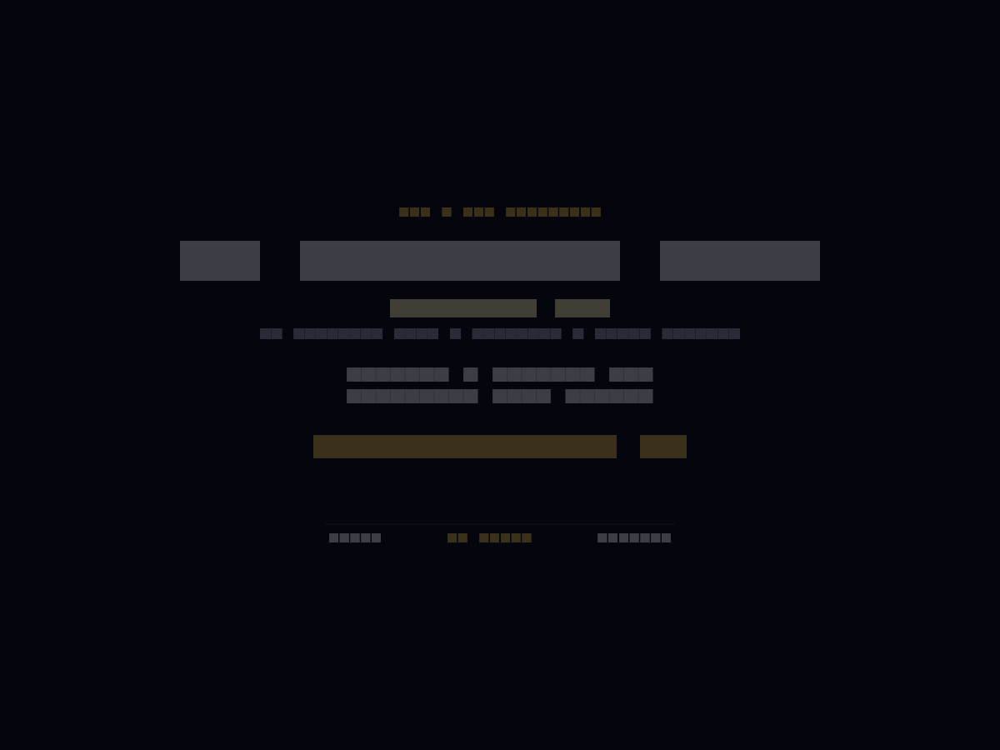

# Aurum Signal

*A tribute to Voyager 1 · One Light-Day*

An unofficial, fan-made Flutter tribute to Voyager 1 reaching one light-day
from Earth on 18 November 2026. Not affiliated with or endorsed by NASA/JPL.
All NASA media used here is credited in [docs/ASSETS.md](docs/ASSETS.md); the
app also has an in-app **Disclaimer & credits** page.




Full-screen captures require a device or browser run; these two images are the
committed golden tests for the intro's Morse and date moments.

## What it does

- A first-launch, sound-and-light intro: **Touch to transmit** gate, VGR in
  Morse, the milestone date and distance, then VOYAGER in Morse.
- A single Morse timeline drives audio, glyph animation, haptics and captions.
  No strobing; reduce-motion, sound and haptics are configurable.
- Offline live distance from an embedded JPL Horizons ephemeris, with AU,
  light-time and round-trip signal delay.
- Signal-journey visualisation, mission timeline, light-time ladder,
  true-distance horizontal scroll, true-size lineup and Pale Blue Dot section.
- Golden Record watermark that rotates with scroll, gentle starfield,
  responsive layout, downloaded fonts and full offline operation.
- Replayable intro, Settings, Sources, About and a separate Disclaimer page.

## Run it

```bash
flutter pub get
flutter run
```

Release APK:

```bash
flutter build apk --release
```

Web:

```bash
flutter build web --release
```

## Regenerate generated files

```bash
python3 tool/fetch_ephemeris.py   # assets/data/v1_distance.json (JPL Horizons)
dart run tool/gen_audio.dart      # assets/audio/*.wav (660 Hz Morse + burst)
dart run tool/measure_sync.dart   # audio-to-timeline drift report
dart run flutter_launcher_icons
dart run flutter_native_splash:create
```

`tool/fetch_ephemeris.py` needs Python 3 and network access to
`https://ssd.jpl.nasa.gov/api/horizons.api`. The committed JSON means the app
itself never needs the network.

## Verify

```bash
dart format --set-exit-if-changed .
flutter analyze
flutter test
```

To refresh the two golden images above:

```bash
flutter test --update-goldens test/golden_test.dart
```

## Deploy

GitHub Actions runs analyze, format check and tests on every push/PR. On
`main`, it also builds the web app with `--base-href` derived from the
repository name and deploys it to GitHub Pages, and uploads a debug APK as an
artifact. Pages must be set to **GitHub Actions** as the source.

Before publishing, replace the repository placeholder in
`lib/core/data/facts.dart` (`repositoryUrl`) and the package id placeholder
`com.example.aurum_signal` in the Android/iOS project files.

## Credits and licence

App code: MIT — see [LICENSE](LICENSE). Contributions are welcome; see
[CONTRIBUTING.md](CONTRIBUTING.md).

Images and the 3D model: NASA/JPL-Caltech, downloaded from public NASA pages.
They are not ours and we claim no copyright over them. Fonts are OFL; licences
are in `docs/`. Facts and source URLs are recorded in
[docs/SOURCES.md](docs/SOURCES.md). Design and implementation decisions are in
[docs/DECISIONS.md](docs/DECISIONS.md), asset details in
[docs/ASSETS.md](docs/ASSETS.md) and sync measurements in
[docs/SYNC_MEASUREMENT.md](docs/SYNC_MEASUREMENT.md).

Inspired by NASA's *Shine Bright for Voyager's Light-Day*. Copyright concerns:
subedigokul119@gmail.com.
